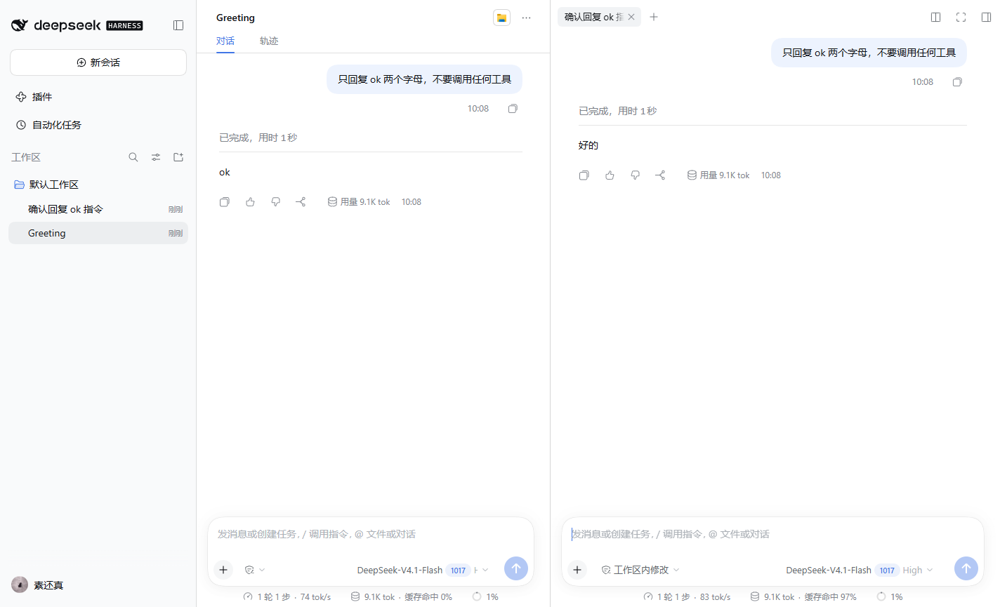
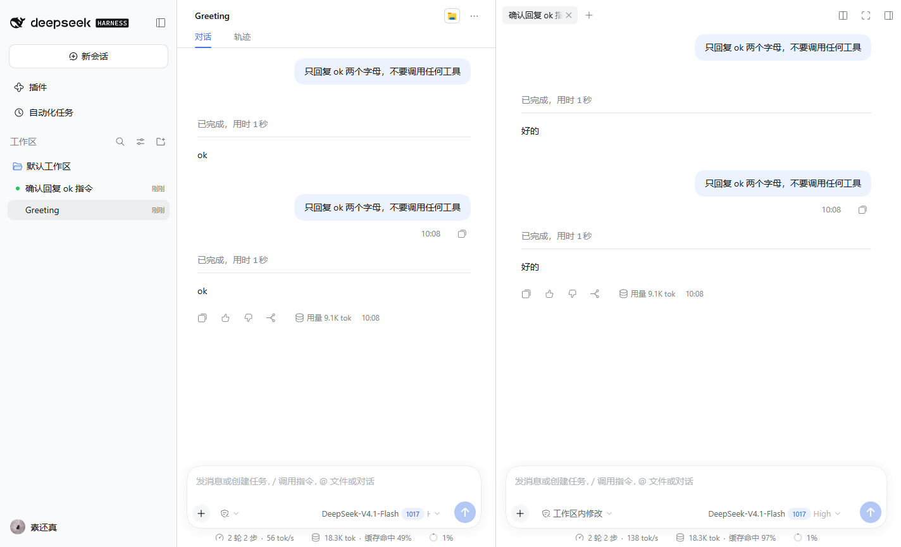
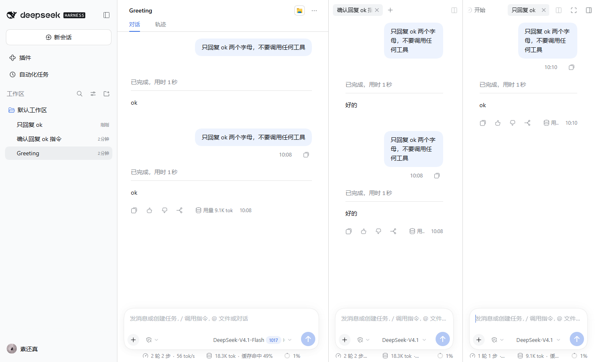
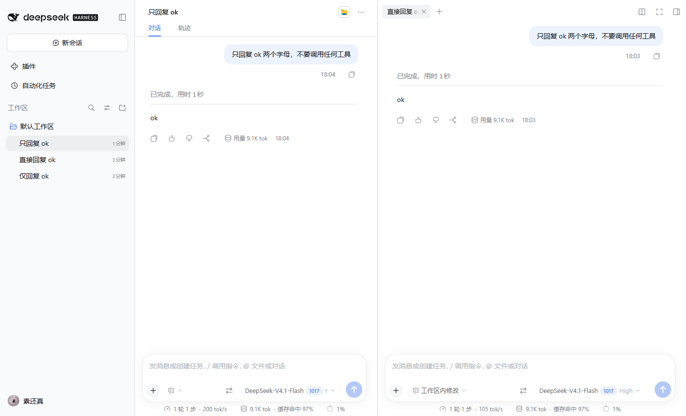
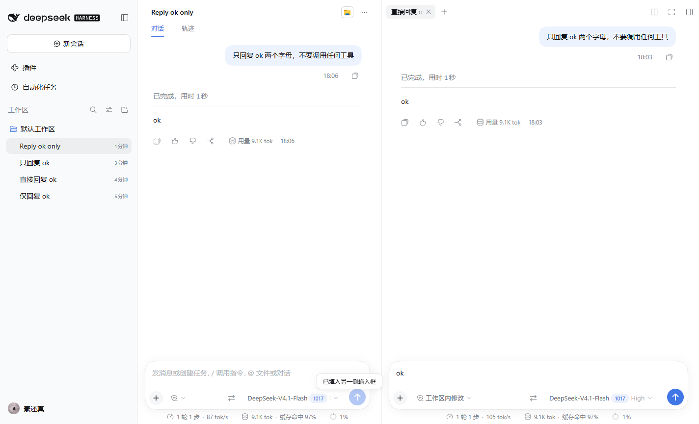
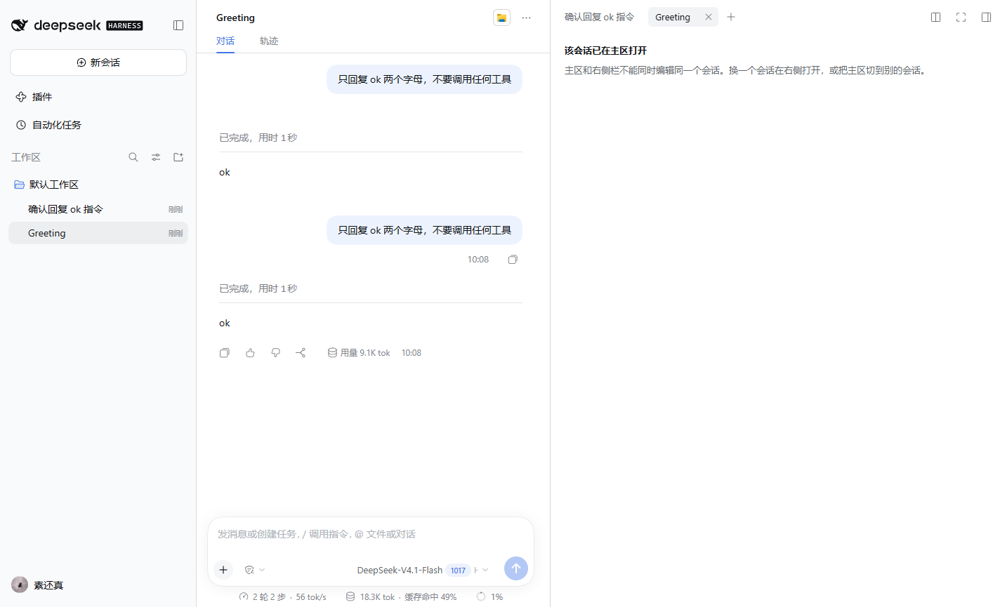
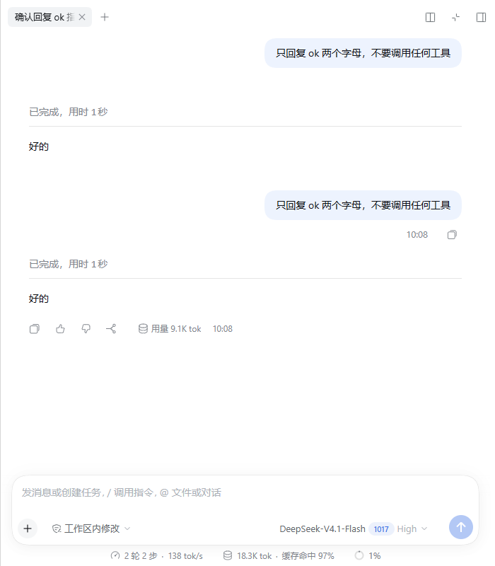
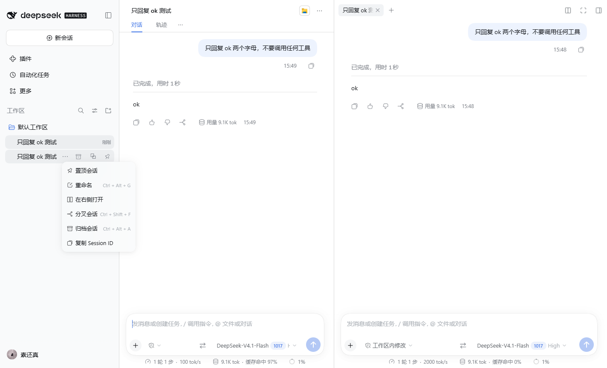

# dsh-split-chat

在 [DeepSeek Harness](https://github.com/deepseek-ai/deepseek-harness)（DSH）的**右侧栏**里打开第二个、第三个完整对话 —— 主区对话不动，两边都能输入、审批、停止。

Open any DSH session as a full chat tab in the right sidebar, while the main area keeps its own conversation. Both panes are fully interactive; a split right pane gives you up to three conversations side by side.



## 功能

| 场景 | 行为 |
|---|---|
| 会话行 `...` 菜单 | 新增 **「在右侧打开」**——文案与内置行同款，只写动作、不重复会话名（内置是「重命名」「归档会话」这种），并且和它们一样带 `icon`，不是纯文字行；点击后右栏自动展开，出现该会话的对话 tab |
| 会话行悬停按钮 | 同一个动作的图标按钮（⧉） |
| 打开后 | 右侧 tab 里是**完整对话 + 输入框**，可正常发消息 / 审批 / 停止；主区对话保持不动 |
| 重复打开同一会话 | 聚焦已有 tab（框架按 `contentId` 去重），不会重复创建 |
| 关闭 tab / 收起右栏 | 释放该会话保留，不影响主区 |
| 关闭右栏对话后切换会话 | **不会从其它会话的旧布局里弹回来**（关闭是全局的；0.2.2 修复） |
| 右栏分栏 | 右栏可再分一格 → **主区 + 右栏最多 3 个对话** |
| 主区切到别的会话 | **已打开的右栏对话会跟着走**（不再按主会话隔离），切到新会话也保留；原本收起的右栏保持收起 |
| 右侧打开的正是主区当前会话 | tab 内显示「该会话已在主区打开」，不重复挂载编辑器（会话编辑器是单 root 设计） |
| 跨栏发送 | 两个输入框旁都有 **⇄**：把本栏选中的文字（没选中时取最后一条回复）填到**另一侧输入框**；**Shift+点击**直接发送 |

## 截图

| 两边各自独立收发（主区 8 条 / 右栏 8 条） | 分栏 → 3 个对话 |
|---|---|
|  |  |

| 切主会话，右栏对话跟着走 | 跨栏发送：主区 ⇄ → 右栏输入框 |
|---|---|
|  |  |

| 同一会话已在主区 | 窄窗口自动全屏 |
|---|---|
|  |  |

| 菜单行与内置行对齐（`icon` + 动作文案） |
|---|
|  |

## 安装

要求：DSH `0.2.1-rc.5`（rc.2 / rc.3 / rc.5 均已实测；desktop 与 Web 使用同一套 client 插件机制）。插件只硬依赖 `slots` / `locale` 两个稳定核心服务，其余宿主能力在运行时探测、缺失时降级——见「抗 DSH 升级」。

### 方式 A：插件页 / plugin_manager

把本目录（或 clone 下来的目录）作为本地插件安装：

- GUI：设置 → 插件 → 添加插件 → 本地绝对路径
- CLI：`dsh plugin --profile <profile> add link:<本目录绝对路径>`

安装器会同时写入 profile 的 `dependencies` 和 `dsh.profile.bundles`（本包声明了 `dsh.bundle.patch`）。

### 方式 B：手工

编辑 profile `package.json`：

```jsonc
{
  "dependencies": {
    "dsh-split-chat": "link:D:/path/to/dsh-split-chat"
  },
  "dsh": {
    "profile": {
      "bundles": [
        // ...末尾追加
        "dsh-split-chat"
      ]
    }
  }
}
```

然后在 profile 目录执行 `pnpm add link:D:/path/to/dsh-split-chat`，重启客户端。

> **存放位置很重要**：把本目录放在 **DSH 安装目录之外**（不要放在 `D:\dsh` 里面）。DSH 桌面版升级/重装会清空安装目录，放在里面的插件源码会被一并删掉，profile 里的 `link:` 随即失效——这是“升级后插件没了”最常见的原因。

> 实测 0.2.1-rc.5：**新装**的 client bundle 会经 client-modules 的 HMR 通道热生效，不重启也能用（菜单会直接出现）。若页面断线或没跟上，刷新页面；仍不行再重启。**改 `lib/client.js` 之后**若页面没跟上，也刷新/重启一次。

## 使用

1. 左侧会话行 → `...` → **「在右侧打开」**（或悬停行点 ⧉）。
2. 右栏出现该会话的对话 tab，正常发消息即可。
3. 右栏标题栏的 `+` / 分栏按钮可以再开一格；`×` 关闭 tab。
4. 主区切到别的会话：**右栏对话跟着过去**（全局右栏）；想清空右栏就关掉 tab。
5. 想把内容搬到另一侧：在对话里选中一段文字（或不选，默认取最后一条回复），点输入框旁的 **⇄** —— 内容会填进另一侧的输入框，检查后按回车即可；按住 **Shift** 点 ⇄ 则直接发送。

> ⚠️ **会话行必须有至少一条消息**（非 blank）才会显示 `...` 菜单和悬停按钮 —— 这是 DSH 本身对 blank 会话的规则，不是插件的问题。新会话先发一句话即可。

## 工作原理

```text
会话行 ... / 悬停 ⧉
  → ctx.sidebarRight.openResource('dsh-resource://splitchat/session/<id>', { kind: 'splitchat' })
  → 右栏按 kind 找到本插件注册的 tab 类型
  → tab body（sidebar.right.pane.tab, key = 类型 id）读取资源地址
  → splitchat 资源 provider：ctx.sessions.retain(id, { source: 'splitChat', signal })
  → SessionProvider(reference) 渲染 splitchat.conversation
  → renderFactorySlot('conversation.content', { variant: 'embedded', phase, hero },
                       { slots: { views: FixedChatView } })
  → 共享对话正文 + Composer（走该会话自己的 Session Controller）
```

两个附加机制：

- **全局跟随**：订阅 `ctx.sidebarRight.mounted`（当前主会话）。主区切到另一个会话时，把上一块右栏面板里的 `splitchat` tab 在**新主会话**里重新 `openResource`（宿主 dock 布局按会话保存，这是让 tab 呈现"全局"的唯一方式）。新会话 dock 还没就绪时自动重试；上一块面板原本是收起的，跟随后再收起，不强行弹开。
- **跨栏发送**：`conversation.input.right` 里注册一个 ⇄ 按钮；点击时读取本栏选区或最后一条 `assistant-step` 正文，经 `ctx.get('conversation').input.shell(目标会话).actions` 写入目标输入框（`setDraft`，Shift 时再 `submit()`），与 Composer 用的是同一套输入门面。

注册清单（全部在 `lib/client.js` 的 `apply()`）：

| 注册点 | 内容 |
|---|---|
| `ctx.resources.register` | `splitchat` 资源协议（`dsh-resource://splitchat/session/<id>`） |
| `ctx.sidebarRightTabs.register` | tab 类型：id `dsh-split-chat`、kind `splitchat`、`patterns`、`priority: 'extension'`、`canOpen` / `title` |
| `sidebar.right.pane.tab` | tab 正文（key = 类型 id），声明子 slot `splitchat.conversation` |
| `sidebar.right.pane.tab.title` | tab 标题（实时跟随会话标题） |
| `splitchat.conversation` | 嵌入对话；主区同时保留该会话时显示「已在主区打开」提示 |
| `sidebar.workspaces.session.menu.item` | `...` 菜单行，order 250 |
| `sidebar.workspaces.session.row.action` | 会话行悬停按钮，order 150 |
| `conversation.input.right` | 每个输入框前的 ⇄ 跨栏发送按钮（order 900） |

会话保留用 `ctx.sessions.retain(id, { source: 'splitChat', signal })`：tab 存活期间持有，关闭 tab（资源流 abort）时在 `finally` 里 `release()`。重复会话检测读 `retainedBy.mainView`（`useSessionRetainInfo`）。

## 目录结构

```text
dsh-split-chat/
├── package.json          # dsh.bundle.patch + dsh.client（platform web, entry ./client）
├── cordis.patch.yml      # bundle patch：把自己作为插件行插入 Host
├── lib/
│   ├── index.js          # Host 半区：空插件（只为让 bundle 被加载、client 半区被服务）
│   └── client.js         # 浏览器半区：资源协议 / tab 类型 / tab body / 嵌入对话 / 入口 / 文案 / CSS
├── docs/                 # 截图
└── README.md
```

无构建链：`lib/client.js` 是手写 client-module bundle（`window.__ModuleLoader__.load(...)`）。

## 验证状态（0.2.2 / DSH 0.2.1-rc.5）

2026-11-02 在 **DSH 0.2.1-rc.5** 上完整复跑下表（独立 `DSH_HOME` + 临时 profile，Chrome headless/CDP 自动操作）。rc.5 与 rc.3 的对照：客户端基线（web-frontend / sidebar-right / resources / renderer / session / subagent / locale）**字节一致**，仅 `ui-conversation` 有 +655B 的小改动，核心链路无变化。此前 rc.2、rc.3 同样全表通过。

| 检查 | 0.2.2 / rc.5 结果 |
|---|---|
| `...` 菜单出现「在右侧打开」（带图标、与内置行同列） | 通过 |
| 会话行悬停 ⧉ 按钮同动作 | 通过 |
| 主区与右栏各自发消息、独立运行（两边各 4→8 条） | 通过 |
| 重复打开同一会话 → 聚焦已有 tab，不新增 | 通过 |
| 关闭 tab 释放会话；关最后一个 tab 右栏收起 | 通过 |
| 刷新页面 → tab 与对话恢复 | 通过 |
| 右栏打开主区当前会话 → 「该会话已在主区打开」提示 | 通过 |
| 分栏 → 主区 + 右栏 2 格 = 3 个对话各自可用 | 通过 |
| 切主会话 → 右栏 tab 跟随（含切到全新会话） | 通过 |
| 跟随不会在手动关掉 tab 后复活 | 通过 |
| 跨栏发送 ⇄：主区→右栏、右栏→主区、选中文字引用 | 通过 |
| 关掉右栏对话后，切到其它会话不会弹回已关闭的对话（0.2.2 修复） | 通过 |
| 加载时控制台输出 `[dsh-split-chat] 0.2.2 host capabilities`，各项能力均为 true | 通过 |
| 浏览器控制台在加载/开栏/发消息/关栏过程中无 error/warn | 通过 |

> rc.2 上验证的「窄窗口 <768px → 右栏 fullscreen」属宿主布局行为；rc.3/rc.5 未单独复跑（同一渲染路径，无相关差异）。

## 抗 DSH 升级

DSH 仍在快速迭代，内部接口会变。这个插件用三层做法避免“升级一次就整个用不了”：

1. **源码不放在安装目录**：`D:\dsh` 这类安装目录在升级/重装时会被清空，放在里面的插件源码会被一并删除，profile 的 `link:` 随之失效。插件源码应放在固定目录（如 `G:\Tools\dsh-plugins\`），安装目录怎么升级都不影响。
2. **能力探测 + 功能级降级**：`inject` 只硬依赖 `slots` / `locale` 两个稳定核心服务；`sidebarRight` / `sessions` / `uiWorkspace` / `conversation.input` 全部通过 `ctx.get` 运行时探测。某个能力缺失或被改名时，只关闭对应功能（菜单、右栏、跟随、⇄ 互相独立），不会让整个插件加载失败或让页面报错。
3. **分座位错误边界**：每个 slot 座位（tab 正文、嵌入对话、tab 标题、菜单行、悬停按钮、⇄）各包一层 React error boundary。某个座位的宿主 props 变了，只在该座位显示「插件与当前 DSH 版本不兼容」的降级提示，其余功能继续工作。

升级后可这样自检：浏览器控制台会打印一行 `[dsh-split-chat] <version> host capabilities {…}`，哪项是 `false` 就对应哪块降级；降级发生时还会有 `[dsh-split-chat] degraded capability "<name>"` 的 `console.warn`。更新插件即可恢复完整功能；如果只是源码目录丢了，重新 `link:` 安装一次即可。

## 兼容性 & 已知限制

- 依赖 DSH **内部公共接口**（`sidebarRight` / `sidebarRightTabs` / `sessions.retain` / `conversation.input` / slot 体系）。已在 `0.2.1-rc.2` / `rc.3` / `rc.5` 上逐条核对并验收；`0.2.2` 起改为**能力探测 + 分座位降级**（见「抗 DSH 升级」），接口漂移只会关闭对应功能。大版本升级后仍建议看一眼控制台的 capabilities 行。
- 全局跟随会把当前右栏 tab 写进**新主会话自己的 dock 布局**（宿主按主会话持久化布局，每个访问过的会话各存一份）——这是"全局"在现有框架下的实现方式；关掉 tab 后再切会话不会复活。
- 跨栏发送提取的是**纯文本**（选区或最后一条回复正文），不保留富文本/Markdown 结构；依赖 `conversation.input` 服务，宿主未提供该服务时按钮仍在但会提示失败。
- hero 页（没有选中会话）没有 dock 面：`openResource` 会抛错，本插件回退为**在主区打开**该会话。
- 同一会话不能同时主区 + 右栏编辑（显示提示）；右栏布局按主会话保存。
- 右栏宽度上限：初始 45%、最大 70%、主区保底 400px；窗口 < 768px 时右栏自动全屏（覆盖而非并排）。
- 会话被归档/删除后资源打开失败：tab 显示「无法打开该会话」，关掉即可。
- 不做「在右栏新建会话」。
- 无 Host 逻辑、无数据库变更、无模型/token 成本。

## 版本记录

- **0.2.2**（2026-11-02）：菜单行与内置行对齐（补 `icon`、文案只写动作，来自 #1）；抗 DSH 升级改造——源码建议放在安装目录之外、`inject` 收敛为 `slots`/`locale`、其余服务运行时探测、每个 slot 座位加错误边界与能力自检行；修复「关掉右栏对话后，切到其它会话会从旧布局弹回一堆旧对话」（改为全局 intent + 离开会话时清理副本）；rc.5 全量回归。
- **0.2.1**（2026-10-26）：DSH `0.2.1-rc.3` 适配验证版本——rc.3 全量回归通过；rc.2→rc.3 客户端包 API 逐项核对无破坏性变更，`lib/client.js` 未改；README 补充 rc.3 验证表与兼容范围。
- **0.2.0**（2026-10-20）：右栏 tab 跨主会话跟随；输入框旁 ⇄ 跨栏发送。
- **0.1.0**：初版（会话行「在右侧打开」+ 右栏完整对话）。

## License

[MIT](LICENSE)
